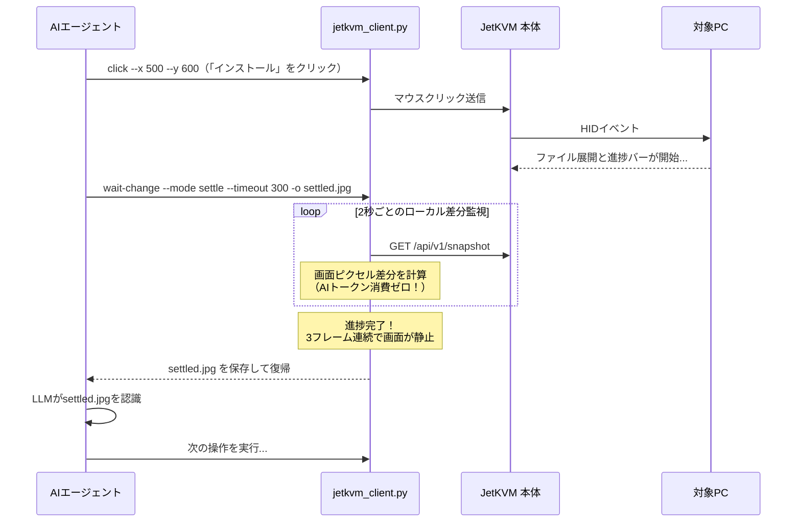

# JetKVM Controller

[](LICENSE)
[](https://www.python.org/downloads/)
[](https://jetkvm.com/)

[English](README.md) | [日本語](README.ja.md)

**JetKVM Controller** は、ネットワーク経由で [JetKVM](https://jetkvm.com/) を遠隔操作し、実機PCやサーバーのキッティング・BIOS設定・OSインストールを自動化するための軽量CLIツールおよびAIエージェント向けスキルです。

対象PC側にエージェントやソフトウェアを一切インストールすることなく、完全なエージェントレスで操作可能です。また、OSインストール中や再起動中の画面変化・安定をローカルで判定する**画面差分検知（Frame-Diff Throttling）機能**を搭載しており、AIエージェント運用のトークン消費とAPIコストを劇的に削減します。

---

## 🌟 主な特徴

- ⚡ **Frame-Diff Throttling（トークン・コスト削減）**:
  長時間のインストールバーや再起動ループ中にAIへ毎秒スクショを送る無駄を排除。ローカルでフレーム差分を監視し、「画面が切り替わった瞬間」や「処理が完了して画面が静止した瞬間」だけ画像を取得してLLMに渡します。
- 🖥️ **完全エージェントレス**:
  JetKVMのREST / JSON-RPC API経由で直接操作。キッティング対象PCへの事前設定やドライバーインストールは不要です。
- ⌨️ **HID入力のエミュレーション**:
  ファンクションキー（`F2`, `F12`, `Esc`）を含む単一キー入力、修飾キー（`Ctrl`, `Alt`, `Shift`, `Win`）のコンビネーション入力、文字列の自動タイピング、マウスの絶対座標クリック・ダブルクリックに対応。
- 💿 **仮想メディアマウント**:
  HTTPサーバー上のブータブルISOイメージをリモートからマウント可能。
- 🔌 **ATX電源制御**:
  マザーボードの電源ピンと連動し、電源ボタン短押し、長押し（強制終了）、リセットを実行可能。
- 🤖 **AIエージェント対応**:
  Google Antigravity、Claude Code、CursorなどのAIアシスタントに即座に組み込める `SKILL.md` を同梱。

---

## 💡 なぜ Frame-Diff Throttling が必要なのか？

AIエージェントにWindows OOBEやLinuxインストーラーの操作を任せる際、ファイルの展開や更新で10〜30分待機することがあります。

- **従来の素朴なアプローチ**:
  5秒おきに画面キャプチャをマルチモーダルLLMへ送信し続けると、何百回もの無駄なAPI呼び出しと数百万トークンを浪費します。
- **JetKVM Controller のアプローチ**:
  1. AIが「次へ」ボタンをクリック。
  2. 直後にローカルスクリプト `wait-change --mode settle` を実行。スクリプトが軽量にフレーム間差分を計算しながら待機。
  3. プログレスバーが止まり、次の設定画面で静止したことを検知すると終了。
  4. **完了した1枚の画像だけ**をAIに渡すため、APIトークン消費量を90%以上削減可能。

---

## 🚀 クイックスタート

### 前提条件

- Python 3.8 以上
- ネットワークに接続された JetKVM 本体
- （推奨）`Pillow`（画像処理の高速化に使用。未インストールの場合は簡易バイト差分比較へ自動フォールバック）

```bash
git clone https://github.com/cwatanab/jetkvm-controller.git
cd jetkvm-controller

# 選択肢 A: CLIコマンド (`jetkvm`) としてインストール
pip install -e .

# 選択肢 B: 依存ライブラリのみ導入して直接スクリプト実行
pip install -r requirements.txt
```

### 接続設定

環境変数またはコマンドライン引数で JetKVM の接続先を設定します：

```bash
# 環境変数で指定する場合（推奨）
export JETKVM_HOST="http://192.168.1.100"
export JETKVM_PASSWORD="your-secure-password"

# Windows PowerShell の場合:
# $env:JETKVM_HOST = "http://192.168.1.100"
# $env:JETKVM_PASSWORD = "your-secure-password"
```

各コマンドの引数に直接 `--host` や `--password` を付与することもできます。

---

## 📖 CLI コマンドリファレンス

インストールした `jetkvm` コマンドで直接実行できます（`python scripts/jetkvm_client.py` でも同様に実行可能）。
*(以下の例では短く書ける `jetkvm` コマンドで記載しています)*

### 1. スマート待機 (`wait-change`)

#### `change` モード（画面の遷移待ち）
キー入力やボタンクリック後、画面が切り替わるまで待機します：
```bash
python scripts/jetkvm_client.py wait-change \
  --mode change \
  --threshold 5.0 \
  --timeout 60 \
  -o next_screen.jpg
```

#### `settle` モード（処理の完了・静止待ち）
インストーラーのプログレスバーやスピナーが終わり、画面の動きが止まるまで待機します：
```bash
python scripts/jetkvm_client.py wait-change \
  --mode settle \
  --threshold 1.5 \
  --stable-frames 3 \
  --timeout 300 \
  -o settled_screen.jpg
```

| 引数 | デフォルト値 | 説明 |
|---|---|---|
| `--mode` | `change` | `change`: 画面変化を検知 / `settle`: 画面の静止・完了を検知 |
| `--threshold` | `5.0` | 差分パーセンテージのしきい値（0.0 - 100.0%） |
| `--interval` | `2.0` | ポーリング間隔（秒） |
| `--timeout` | `120` | タイムアウト秒数 |
| `--stable-frames` | `2` | `settle` モードで静止と判定するために必要な連続フレーム数 |
| `--output`, `-o` | *(なし)* | 検知完了時のスクリーンショット保存先パス |

---

### 2. 単一スクリーンショット取得 (`screenshot`)

現在の画面を1枚撮影して保存します：
```bash
python scripts/jetkvm_client.py screenshot --output screen.jpg
```

---

### 3. キーボード入力 (`press` / `type`)

#### 単一キーまたはショートカットキーの送信:
```bash
# BIOS画面へ入るためのF2キー
python scripts/jetkvm_client.py press --key f2

# Enter / Esc
python scripts/jetkvm_client.py press --key enter

# Ctrl + Alt + Delete
python scripts/jetkvm_client.py press --key delete --modifiers ctrl alt

# Win + R（ファイル名を指定して実行）
python scripts/jetkvm_client.py press --key r --modifiers win
```

#### 文字列の連続タイピング:
```bash
python scripts/jetkvm_client.py type --text "Administrator" --delay 20
```

---

### 4. マウス入力 (`click`)

画面の絶対座標を指定してクリック・ダブルクリックを送信します：
```bash
# 通常の左クリック
python scripts/jetkvm_client.py click --x 960 --y 540

# ダブルクリック
python scripts/jetkvm_client.py click --x 100 --y 200 --double

# 右クリック
python scripts/jetkvm_client.py click --x 500 --y 300 --button right
```

---

### 5. 仮想メディア（ISOマウント） (`mount`)

HTTP上のISOイメージファイルを JetKVM にリモートマウントします：
```bash
python scripts/jetkvm_client.py mount --url "http://192.168.1.50:8000/windows11.iso"
```

---

### 6. ATX 電源制御 (`power`)

対象PCの電源ボタン操作を実行します：
```bash
# 電源ボタン短押し（電源ON / 通常シャットダウン）
python scripts/jetkvm_client.py power --action short-press

# 長押し（強制電源OFF）
python scripts/jetkvm_client.py power --action long-press

# リセット
python scripts/jetkvm_client.py power --action reset
```

---

## 🤖 AIエージェントとの協調フロー例

AIコーディングエージェント（Antigravity等）が本ツールを使ってトークンを浪費せずにOSインストールを進める流れ：



---

## 📁 ディレクトリ構成

```
jetkvm-controller/
├── SKILL.md                 # Antigravity / AI Agent スキル定義
├── pyproject.toml           # パッケージ定義＆CLIコマンド (`jetkvm`)
├── requirements.txt         # 依存パッケージ定義（Pillow）
├── scripts/
│   └── jetkvm_client.py     # メインCLIスクリプト（差分検知アルゴリズム内蔵）
├── .gitignore
├── LICENSE                  # MIT ライセンス
├── README.md                # 英語ドキュメント
└── README.ja.md             # 日本語ドキュメント
```

---

## 📄 ライセンス

このプロジェクトは [MIT License](LICENSE) の下で公開されています。
