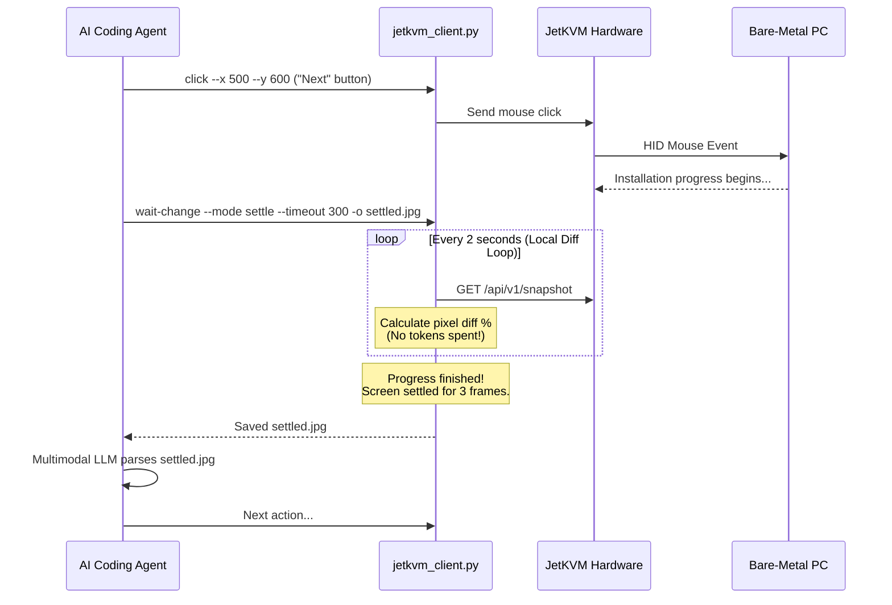

# JetKVM Controller

[](LICENSE)
[](https://www.python.org/downloads/)
[](https://jetkvm.com/)
[](SKILL.md)

[English](README.md) | [日本語](README.ja.md)

**JetKVM Controller** is a lightweight, agentless automation tool and AI agent skill designed to control physical PCs and servers via [JetKVM](https://jetkvm.com/) over the local network.

It enables bare-metal PC kitting, BIOS/UEFI configuration, and OS installation automation without installing any agent or software on the target machine. Most importantly, it features **smart frame-difference detection (Frame-Diff Throttling)** to dramatically reduce LLM token consumption and API costs during long unattended setup and installation cycles.

---

## 🌟 Key Features

- ⚡ **Frame-Diff Throttling (Cost & Token Saver)**:
  Instead of sending raw screen polls to AI models every few seconds during installation bars or reboot cycles, monitor screen state locally. Only return screenshots to the LLM when an interactive screen actually changes or settles.
- 🖥️ **Agentless Remote Control**:
  Operates completely over the JetKVM REST/JSON-RPC API. No drivers or software needed on the target host.
- ⌨️ **Full HID Input Emulation**:
  Send single keystrokes (including function keys like `F2`, `F12`, `Esc`), key combinations (`Ctrl`, `Alt`, `Shift`, `Win`), text typing with configurable delays, and absolute mouse clicks / double-clicks.
- 💿 **Virtual Media Mounting**:
  Mount bootable ISO images remotely via URL.
- 🔌 **ATX Power Control**:
  Trigger short-press, long-press, or reset actions for remote power cycling.
- 🤖 **AI-Agent Ready**:
  Pre-packaged with `SKILL.md` for seamless integration with Google Antigravity, Claude Code, Cursor, and other agentic workflows.

---

## 💡 Why Frame-Diff Throttling?

When an AI agent automates an OS install (e.g. Windows OOBE, Ubuntu installer), progress bars or spinning wheels can run for 10–30 minutes.

- **Naive approach**: Polling screenshots every 5 seconds and sending them to a multimodal LLM consumes hundreds of calls and millions of vision tokens.
- **JetKVM Controller approach**:
  1. Trigger user action (e.g., Click "Install Now").
  2. Run `wait-change --mode settle` locally. The script downsamples and compares consecutive video frames.
  3. Once the screen stops moving (reaches a steady prompt or error), it captures the final frame.
  4. The LLM processes **only one final snapshot**, saving >90% of token costs and preventing hallucinations during transient states.

---

## 🚀 Quick Start

### Prerequisites

- Python 3.8 or later
- JetKVM connected to target hardware and network
- Optional (recommended): `Pillow` for accelerated image comparison (falls back to sample-byte diff if not installed)

```bash
git clone https://github.com/cwatanab/jetkvm-controller.git
cd jetkvm-controller

# Option A: Install as CLI tool (`jetkvm` command)
pip install -e .

# Option B: Run directly with requirements
pip install -r requirements.txt
```

### Configuration

Set connection details via environment variables or CLI flags:

```bash
# Environment variables (recommended)
export JETKVM_HOST="http://192.168.1.100"
export JETKVM_PASSWORD="your-secure-password"

# Windows PowerShell:
# $env:JETKVM_HOST = "http://192.168.1.100"
# $env:JETKVM_PASSWORD = "your-secure-password"
```

You can also pass `--host` and `--password` directly to any command.

---

## 📖 CLI Usage & Command Reference

You can use the installed `jetkvm` command directly, or run `python scripts/jetkvm_client.py`.
*(Commands below use `jetkvm` for brevity)*

### 1. Smart Waiting (`wait-change`)

#### Mode: `change`
Wait until the screen transitions to something new (e.g. after pressing Enter):
```bash
python scripts/jetkvm_client.py wait-change \
  --mode change \
  --threshold 5.0 \
  --timeout 60 \
  -o next_screen.jpg
```

#### Mode: `settle`
Wait until progress bars / spinning animations stop moving and screen stabilizes:
```bash
python scripts/jetkvm_client.py wait-change \
  --mode settle \
  --threshold 1.5 \
  --stable-frames 3 \
  --timeout 300 \
  -o settled_screen.jpg
```

| Parameter | Default | Description |
|---|---|---|
| `--mode` | `change` | `change`: wait for screen difference; `settle`: wait for screen to become still |
| `--threshold` | `5.0` | Pixel difference percentage threshold (0.0 - 100.0%) |
| `--interval` | `2.0` | Polling interval in seconds |
| `--timeout` | `120` | Max seconds to wait before giving up |
| `--stable-frames` | `2` | Consecutive frames required below threshold in `settle` mode |
| `--output`, `-o` | *(none)* | File path to save the resulting snapshot image |

---

### 2. Capture Single Screenshot (`screenshot`)

Capture an instantaneous screen capture:
```bash
python scripts/jetkvm_client.py screenshot --output screen.jpg
```

---

### 3. HID Keyboard Input (`press` & `type`)

#### Press Single Key or Shortcut:
```bash
# BIOS setup key
python scripts/jetkvm_client.py press --key f2

# Enter / Escape
python scripts/jetkvm_client.py press --key enter

# Shortcut combination (e.g., Ctrl + Alt + Delete)
python scripts/jetkvm_client.py press --key delete --modifiers ctrl alt

# Open Run dialog (Win + R)
python scripts/jetkvm_client.py press --key r --modifiers win
```

#### Type String:
```bash
python scripts/jetkvm_client.py type --text "Administrator" --delay 20
```

---

### 4. HID Mouse Input (`click`)

Click or double-click at absolute X/Y screen coordinates:
```bash
# Left click
python scripts/jetkvm_client.py click --x 960 --y 540

# Double click
python scripts/jetkvm_client.py click --x 100 --y 200 --double

# Right click
python scripts/jetkvm_client.py click --x 500 --y 300 --button right
```

---

### 5. Virtual Media (`mount`)

Remotely mount an ISO image over HTTP:
```bash
python scripts/jetkvm_client.py mount --url "http://192.168.1.50:8000/windows11.iso"
```

---

### 6. ATX Power Control (`power`)

Trigger motherboard front-panel power signals:
```bash
# Short press power button (turn on / graceful shutdown)
python scripts/jetkvm_client.py power --action short-press

# Long press (forced shutdown)
python scripts/jetkvm_client.py power --action long-press

# Reset
python scripts/jetkvm_client.py power --action reset
```

---

## 🤖 AI Agent Workflow Recipe

Here is how an AI agent uses `jetkvm-controller` for automated OS installation without token waste:



---

## 📁 Repository Structure

```
jetkvm-controller/
├── SKILL.md                 # Antigravity / AI Agent skill specification
├── pyproject.toml           # Packaging & CLI entry point (`jetkvm`)
├── requirements.txt         # Optional dependencies (Pillow)
├── scripts/
│   └── jetkvm_client.py     # Main CLI script with frame-diff algorithm
├── .gitignore
├── LICENSE                  # MIT License
├── README.md                # English documentation
└── README.ja.md             # Japanese documentation
```

---

## 📄 License

This project is licensed under the [MIT License](LICENSE).
